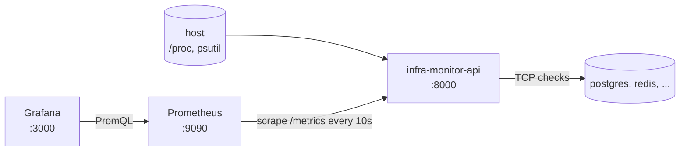

# infra-monitor-api

[](https://github.com/davinnsc/infra-monitor-api/actions/workflows/ci.yml)

**[English](#english) | [Português](#português)**

A small FastAPI service that exposes host metrics (CPU, memory, disk, network) as **JSON** and in **Prometheus** format, plus TCP health checks for the services the host depends on. Ships with a Docker Compose stack (API + Prometheus + Grafana) and a ready-made dashboard.



---

## English

### Quick start

```bash
docker compose up -d --build
```

| URL | What |
|---|---|
| http://localhost:8000/docs | API docs (Swagger) |
| http://localhost:9090 | Prometheus |
| http://localhost:3000 | Grafana, opens straight on the **Infra Monitor** dashboard |

The demo checks Prometheus, Grafana and one service that does not exist, so you can see `UP` and `DOWN` side by side.

### Endpoints

| Method | Path | Returns |
|---|---|---|
| GET | `/health` | Liveness: `{"status": "ok"}` |
| GET | `/metrics/system` | CPU (total, per core, load average), memory, swap, disks, network, uptime |
| GET | `/health/services` | TCP check of every configured service. **200** if all are up, **503** otherwise |
| GET | `/metrics` | Prometheus text format |

### Configuration

| Variable | Default | Example |
|---|---|---|
| `INFRA_MONITOR_SERVICES` | empty | `postgres=db:5432,redis=cache:6379` |
| `INFRA_MONITOR_CHECK_TIMEOUT` | `1.0` | seconds per check |

A malformed `INFRA_MONITOR_SERVICES` stops the app at startup instead of failing later.

### Prometheus metrics

| Metric | Type | Labels |
|---|---|---|
| `infra_cpu_usage_percent` | gauge | `cpu` (`total`, `0`, `1`...) |
| `infra_cpu_count` | gauge | `kind` |
| `infra_load_average` | gauge | `period` |
| `infra_memory_bytes`, `infra_swap_bytes` | gauge | `state` |
| `infra_memory_usage_percent` | gauge | |
| `infra_disk_bytes` / `infra_disk_usage_percent` | gauge | `mountpoint` (+ `state`) |
| `infra_network_bytes_total` / `infra_network_errors_total` | counter | `interface`, `direction` |
| `infra_uptime_seconds` | gauge | |
| `infra_service_up` | gauge | `service`, `target` |

### Design decisions

- **Metrics are read at scrape time** by a custom collector, never cached, so Prometheus always gets fresh values and nothing runs in the background.
- **Network bytes are counters**, so `rate()` gives throughput. Usage values are gauges.
- **Service checks run in parallel**: a dead service costs one timeout, not one per service.
- **CPU counters are primed at startup**: `psutil.cpu_percent()` returns 0.0 on its first call.
- **Docker image**: multi-stage build with `uv`, runs as a non-root user, has a `HEALTHCHECK`.
- **CI** (GitHub Actions): ruff, pytest, image build and a smoke test against the running container.

> Inside a container the API reports what the container can see (its own filesystems and network interfaces). To monitor a machine, run it directly on that machine.

### Development

```bash
uv sync
uv run uvicorn app.main:app --reload
uv run pytest
uv run ruff check . && uv run ruff format --check .
```

---

## Português

API em FastAPI que mostra as métricas da máquina (CPU, memória, disco, rede) em **JSON** e no formato do **Prometheus**, e testa por TCP se os serviços dos quais a máquina depende estão no ar.

- **Subir tudo:** `docker compose up -d --build` e abrir http://localhost:3000 (Grafana já abre no painel).
- **`/health/services`** devolve **503** quando algum serviço cai, então dá pra usar direto como health check de load balancer ou de Kubernetes.
- **Configuração:** `INFRA_MONITOR_SERVICES="postgres=db:5432,redis=cache:6379"`.
- **Decisões:** métricas lidas na hora da coleta (sem cache), rede como contador (pra `rate()` funcionar), checks em paralelo, imagem sem root, CI com lint, testes, build e smoke test.

## License

[MIT](LICENSE)
